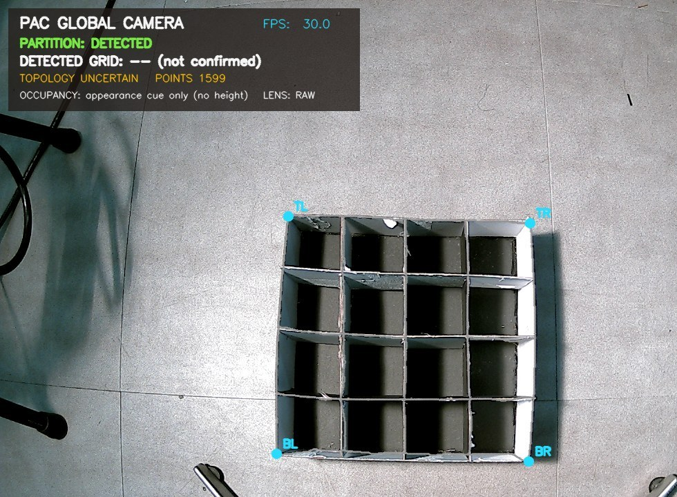
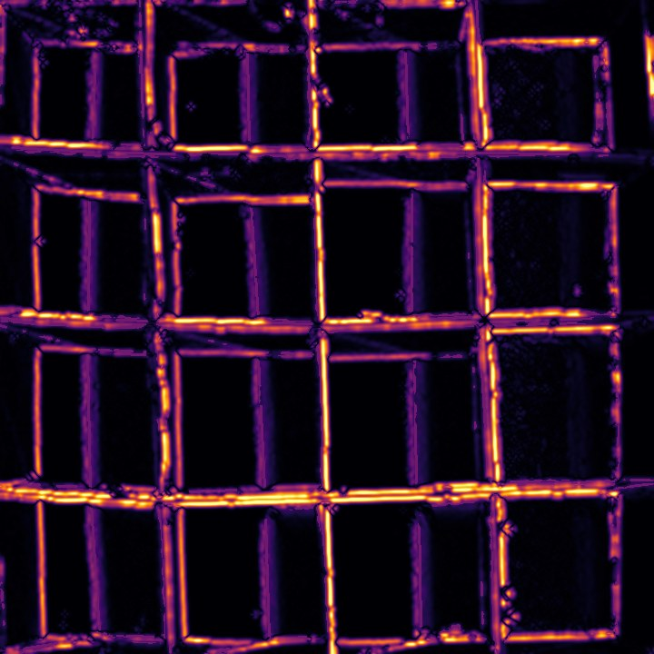
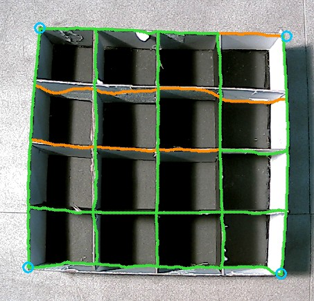
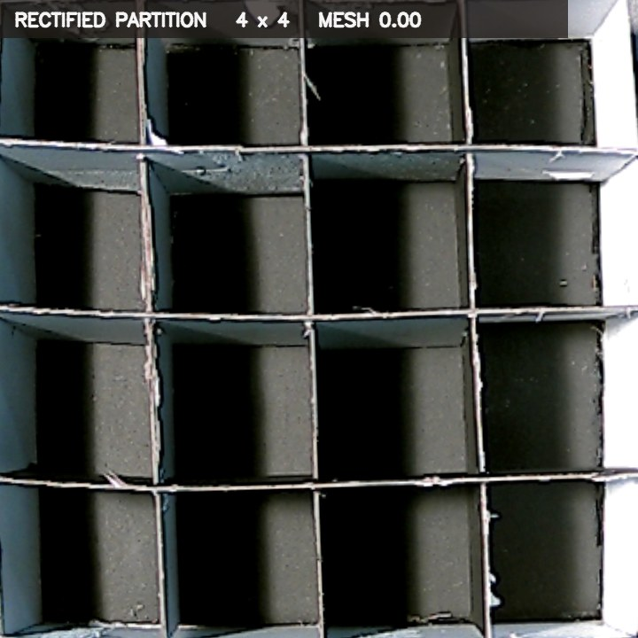
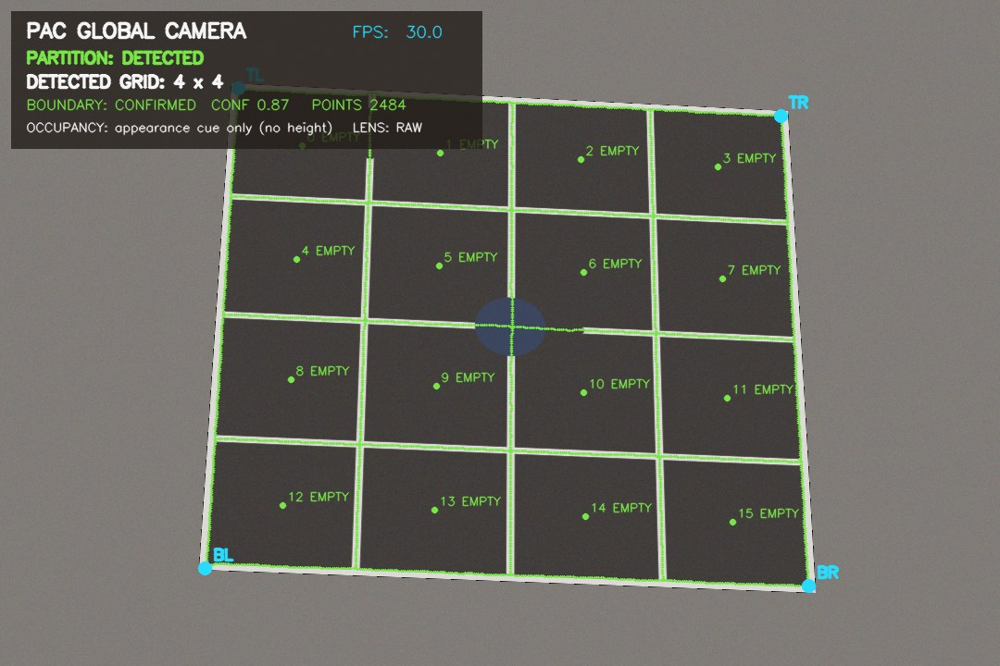
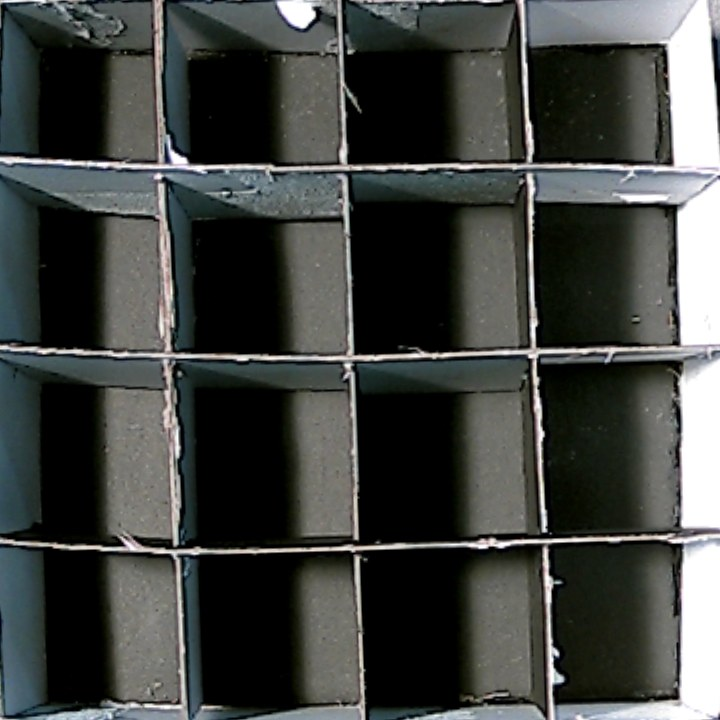

# PAC Global Camera Vision

로봇 팔이 물건을 넣을 칸막이 상자를 위에서 카메라로 보고, 칸이 몇 × 몇인지와 칸마다 물건이 얼마나 쌓였는지를 알려주는 비전 프로그램

팀 프로젝트 · 2026 글로벌 AI로봇 해커톤 · 프로토타입 · GitHub 업로드 2026.11 (실제 진행 과정은 [개발 기록](docs/DEVELOPMENT_LOG.md))

---

## 실제 카메라 영상에서 지금 되는 것과 안 되는 것

<table align="center">
<tr>
<td align="center"> ① 입력 + 외곽 검출</td>
<td align="center"> ② 경계 증거 (원근 보정 후)</td>
<td align="center"> ③ 찾은 경계 (주황: 증거 약함)</td>
<td align="center"> ④ Top View</td>
</tr>
</table>

<table>
<tr><th align="center" width="142"></th><th align="left">결과</th></tr>
<tr><td align="center" width="142">되는 것</td><td align="left">외곽 네 꼭짓점 검출, 원근 보정 Top View, 4×4 칸 개수 인식 (실제 이미지 2장 기준)</td></tr>
<tr><td align="center" width="142">안 되는 것</td><td align="left">경계 상태가 UNCERTAIN에 머물러 자동 확정(CONFIRMED)이 안 됨 ③에서 주황색으로 표시된 가로 경계 몇 개의 증거가 약함</td></tr>
<tr><td align="center" width="142">아직 안 해본 것</td><td align="left">실제 카메라 쌍으로 칸별 높이 측정</td></tr>
</table>

실제 카메라 이미지 2장(원본 프레임 1장, 오버레이가 그려진 예전 화면 캡처 1장, `tests/data/`)을 자동 테스트에 넣어 같은 기준으로 확인한다. 손목 카메라 실제 영상은 아직 검증하지 않았다.

---

## 시스템 구성

<table>
<tr><th align="center" width="135">구성</th><th align="left">내용</th><th align="center" width="175">검증 범위</th></tr>
<tr><td align="center" width="135">입력</td><td align="left">작업대를 위에서 보는 고정 USB 카메라(글로벌) + 로봇 팔 그리퍼에 붙은 손목 카메라 Python · OpenCV · NumPy, ROS 없이 동작</td><td align="center">글로벌 카메라 실제 이미지만</td></tr>
<tr><td align="center" width="135">칸 구조 인식</td><td align="left">외곽을 찾고, 실제로 보이는 칸막이 경계만 이어 붙여 행 · 열을 셈 여러 프레임에 걸쳐 누적해 확정</td><td align="center">실제 프레임: 4×4 인식 확정은 실패</td></tr>
<tr><td align="center" width="135">원근 · 휨 보정</td><td align="left">네 꼭짓점으로 Top View를 만든 뒤 내부 교차점마다 칸별로 따로 보정해 휘어진 칸막이를 폄</td><td align="center">실제 프레임 Top View 휨 보정은 합성</td></tr>
<tr><td align="center" width="135">높이 측정</td><td align="left">글로벌 + 손목 카메라 스테레오로 칸마다 바닥에서 물체 윗면까지 높이를 mm로 계산</td><td align="center">합성 장면만 실제 카메라 쌍 미검증</td></tr>
<tr><td align="center" width="135">출력</td><td align="left">칸마다 ID, 상태(EMPTY / OCCUPIED / UNKNOWN) 높이 · 불확실도를 JSON으로 로봇 쪽에 전달</td><td align="center">테스트에서 JSON 생성 확인</td></tr>
</table>

---

## 담당 역할 및 기여

**팀 프로젝트 | 비전 코드 전체 담당**

<table>
<tr><th align="center" width="150">담당 분야</th><th align="left">수행 내용</th></tr>
<tr><td align="center" width="150">칸 구조 인식</td><td align="left">외곽 검출, 칸막이 경계 찾기 · 따라가기, 행 · 열 자동 판별, 여러 프레임으로 확정</td></tr>
<tr><td align="center" width="150">원근 · 휨 보정</td><td align="left">네 꼭짓점으로 위에서 본 모습(Top View)으로 펴고, 휜 칸막이는 칸별로 따로 보정</td></tr>
<tr><td align="center" width="150">카메라 보정</td><td align="left">렌즈 왜곡 보정, 글로벌 · 손목 카메라 스테레오 보정 도구</td></tr>
<tr><td align="center" width="150">스테레오 높이 측정</td><td align="left">두 영상 정렬, 같은 점 짝짓기 · 잘못된 짝 제거, 3D 위치 계산, 칸별 높이 결정</td></tr>
<tr><td align="center" width="150">검증</td><td align="left">카메라 없이 돌릴 수 있는 합성 장면 생성기와 자동 테스트 43개 실제 카메라 프레임으로 결과가 바뀌지 않는지 확인하는 테스트</td></tr>
</table>

---

## 개발하며 부딪힌 문제

### ① 실제 4×4 상자를 2×2로 잘못 인식했다

<table>
<tr>
<td align="center"> 칸막이마다 윗면 · 벽면 두 줄이 보이는 경계 증거</td>
<td align="center"> 경계 일부가 끊기고 가려진 합성 장면에서 4×4 확정</td>
</tr>
</table>

<table>
<tr><td align="center" width="70">문제</td><td><ul><li>실제 4×4 상자인데 가운데 칸막이 두 개만 또렷하게 보이면 2×2로 판정됐고, 뒤의 Top View · 칸 상태가 모두 그 결과를 따라감</li><li>칸막이 윗면과 벽면이 같이 보이면 선 하나가 두 줄로 잡혀 행 · 열이 늘어나기도 함</li></ul></td></tr>
<tr><td align="center" width="70">원인</td><td><ul><li>처음엔 영상 전체의 가로 · 세로 밝기 분포를 평균내고 "같은 간격"으로 나누는 해를 찾았음 → 보이는 선이 적으면 가장 단순한 등간격(2×2)을 고름</li></ul></td></tr>
<tr><td align="center" width="70">구현</td><td>등간격으로 나누는 코드를 지우고, 영상에서 실제로 보이는 경계만으로 칸을 세도록 바꿈<ul><li>경계 찾기: 상자를 위에서 본 모습으로 편 뒤, 픽셀마다 주변 밝기 · 색이 한 방향으로 길게 바뀌는지 계산해 "선처럼 생긴 곳"만 골라냄 (Structure Tensor). 그림자 영향을 줄이려고 밝기는 로그를 씌워서 씀</li><li>선 따라가기: 상자를 가로지르는 선 후보마다 실제로 경계가 보이는 비율로 점수를 매기고, 후보 주변에서 가장 매끄럽게 이어지는 경로를 찾아 휜 칸막이도 따라감 (Dynamic Programming). 중간이 끊겨도 앞뒤가 보이면 이어 붙임</li><li>격자 확인: 칸막이 윗면 · 벽면처럼 나란히 붙은 두 줄은 하나로 합치고, 가로 · 세로 선이 실제로 만나는지 확인한 뒤에만 행 · 열을 확정</li><li>흔들림 방지: 행 · 열은 3프레임 연속 같을 때만 바꾸고, 증거가 없는 곳은 선을 지어내지 않고 UNCERTAIN으로 표시</li></ul></td></tr>
<tr><td align="center" width="70">확인</td><td><ul><li>실제 이미지 2장(원본 1장 · 예전 화면 캡처 1장) 모두 4×4로 인식 (실제 이미지)</li><li>일부 경계가 흐린 4×4 장면에서 프레임이 쌓이며 2×2 → 4×4로 전환, 경계 한 구간이 아예 없으면 15칸 + UNCERTAIN으로 보고 (합성)</li></ul></td></tr>
</table>

### ② 외곽 꼭짓점이 잘리고, 그림자를 경계로 잡았다

<table>
<tr>
<td align="center"> 실제 프레임에서 찾은 경계 (주황: 증거 약함)</td>
<td align="center"> 원근 보정 Top View</td>
</tr>
</table>

<table>
<tr><td align="center" width="70">문제</td><td><ul><li>실제 사진에서 외곽 오른쪽 위 꼭짓점이 안쪽으로 잘려 x = 674 px로 잡힘 (실제 위치 760 px 이상)</li><li>윗변이 상자 테두리(y ≈ 312 px)가 아니라 바닥과 닿는 그림자 경계(y ≈ 336 px)로 끌려 내려감</li><li>칸 바닥에 생긴 칸막이 그림자가 세로 칸막이로 잡힐 위험</li></ul></td></tr>
<tr><td align="center" width="70">원인</td><td><ul><li>윤곽선 근사로 구한 꼭짓점을 그대로 쓰면 모서리가 조금만 가려져도 꼭짓점이 안쪽으로 이동</li><li>"대비가 가장 강한 선"을 고르면 바닥에 닿는 그림자 경계가 실제 테두리보다 강하게 나옴</li></ul></td></tr>
<tr><td align="center" width="70">구현</td><td><ul><li>꼭짓점을 직접 찾지 않고, 외곽의 네 변을 각각 직선으로 맞춘 뒤 직선끼리 만나는 점을 꼭짓점으로 씀 → 모서리가 조금 가려져도 나머지 변이 위치를 잡아줌</li><li>진짜 외곽인지 그림자인지는 칸막이와의 관계로 구분: 외곽 벽은 안쪽으로만 칸막이가 붙어 있고, 바닥 그림자에는 칸막이가 붙어 있지 않음. 이 기준으로 네 변을 다시 골라 꼭짓점을 갱신</li><li>칸 안쪽 그림자는 ①의 선 따라가기에서 급하게 꺾이는 경로를 막아서 걸러냄</li></ul></td></tr>
<tr><td align="center" width="70">확인</td><td><ul><li>오른쪽 위 꼭짓점 x > 760 px로 복구 (실제 이미지 테스트)</li><li>남은 문제: 윗변 위치 · 그림자를 확인하는 원본 프레임 테스트는 4×4 개수는 맞지만 확정까지 못 가서 아직 실패</li></ul></td></tr>
</table>

### ③ 색으로 칸 점유를 판단하려 했지만 믿을 수 없었다

<table>
<tr><td align="center" width="70">문제</td><td><ul><li>처음엔 빈 칸 기준 영상과 지금 영상의 픽셀 · 색 차이로 EMPTY / OCCUPIED를 정하려 했음</li><li>버블랩 반사, 조명 변화, 칸마다 다른 바닥색 때문에 물건이 없어도 OCCUPIED, 바닥과 같은 색 물건은 EMPTY로 나올 수 있음</li></ul></td></tr>
<tr><td align="center" width="70">원인</td><td><ul><li>카메라 한 대의 색 · 밝기는 "바닥과 다르다"는 것만 알려줄 뿐 높이 정보가 없음. 로봇이 알아야 하는 건 "얼마나 쌓였나"</li></ul></td></tr>
<tr><td align="center" width="70">구현</td><td>손목 카메라를 더해 두 카메라로 높이를 직접 재도록 설계를 바꿈 (스테레오)<ul><li>체커보드로 두 카메라의 위치 관계와 바닥 평면을 미리 보정</li><li>두 영상에서 같은 점을 찾아 짝짓고 (특징점 매칭, SIFT), 짝이 애매하거나 두 카메라 위치 관계에 안 맞는 것은 버림 (RANSAC)</li><li>남은 점의 3D 위치로 바닥에서의 높이를 구하고, 칸마다 여러 점이 동의하는 높이를 그 칸의 높이로 씀. 색 · 밝기는 쓰지 않음</li><li>점이 부족하면 UNKNOWN, 보정 파일이 없으면 mm 값을 내지 않음. USB 카메라끼리 동기화가 안 돼서 로봇이 멈췄을 때만 판정</li></ul></td></tr>
<tr><td align="center" width="70">지금 상태</td><td><ul><li>보정값을 아는 합성 장면에서는 0 ~ 60 mm 높이를 칸별 오차 0.2 mm 이하로 계산, 색만 바뀐 칸은 같은 높이로 판정 (합성)</li><li>실제 카메라 쌍으로는 아직 측정하지 않음</li></ul></td></tr>
</table>

---

## 미해결 문제

<table>
<tr><td align="center" width="70">확정 판정</td><td><ul><li>실제 프레임에서 4×4는 맞지만 가로 경계 일부의 증거가 약해 UNCERTAIN에 머무름</li><li>원인 가설: 골판지 칸막이 윗면이 짧은 구간에서 바닥과 대비가 약하거나 그림자와 겹침</li><li>계획: 실제 프레임을 더 모아 확정에 실패하는 경계 구간만 따로 분석</li></ul></td></tr>
<tr><td align="center" width="70">실제 높이</td><td><ul><li>높이를 아는 블록으로 실제 카메라 쌍의 칸별 오차를 측정해야 함</li><li>무늬가 적은 물체 · 반사 표면에서는 대응점이 부족할 수 있음</li></ul></td></tr>
<tr><td align="center" width="70">테스트</td><td><ul><li>자동 테스트 43개 중 원본 프레임 확정 테스트 1개 실패. OpenCV 4.x에서는 합성 스테레오 장면의 모서리 칸 1개가 3D 점 부족으로 UNKNOWN이 되는 경우도 있음</li></ul></td></tr>
</table>

---

알고리즘 상세, 실행 방법, 설정, 보정 절차, 단계별 진행 기록: [docs/DEVELOPMENT_LOG.md](docs/DEVELOPMENT_LOG.md)
